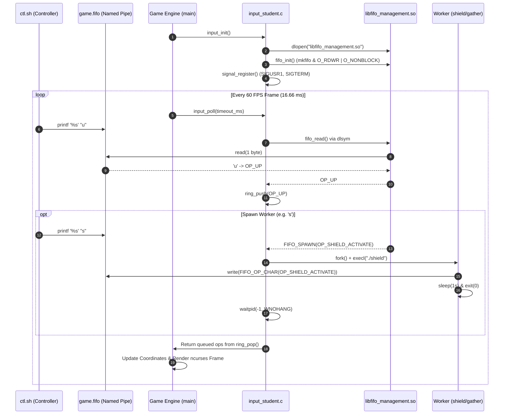

# Linux IPC Game Subsystem: Asynchronous POSIX Architecture & Autonomous Controller

[](LICENSE)
[](#system-architecture)
[](#prerequisites--environment)
[](#overview)
[](#system-architecture)

A high-performance **Inter-Process Communication (IPC)** engine and autonomous gameplay controller engineered for a real-time 2D space shooter in **C11 / POSIX**. Developed as part of the **CMPE 322 (Operating Systems)** curriculum at **Boğaziçi University**.

---

## Table of Contents
- [Overview](#overview)
- [Mission Scenario & Game Mechanics](#mission-scenario--game-mechanics)
- [System Architecture](#system-architecture)
  - [IPC & Process Topology](#ipc--process-topology)
  - [Subsystem Flow](#subsystem-flow)
- [Architectural Deep-Dive](#architectural-deep-dive)
  - [1. Dynamic Shared Object Subsystem (`dlopen` / `dlsym`)](#1-dynamic-shared-object-subsystem-dlopen--dlsym)
  - [2. Non-Blocking Named Pipe (FIFO) Engine](#2-non-blocking-named-pipe-fifo-engine)
  - [3. Concurrent Worker Lifecycle (`fork` / `exec`)](#3-concurrent-worker-lifecycle-fork--exec)
  - [4. Reentrancy-Safe Signal Handling](#4-reentrancy-safe-signal-handling)
  - [5. Lock-Free Circular Ring Buffer](#5-lock-free-circular-ring-buffer)
  - [6. Monotonic Frame Throttling & Polling](#6-monotonic-frame-throttling--polling)
  - [7. Deterministic Control Automation (`ctl.sh`)](#7-deterministic-control-automation-ctlsh)
- [Project Structure](#project-structure)
- [Prerequisites & Environment](#prerequisites--environment)
- [Build and Run](#build-and-run)
  - [Autonomous Mode (Student FIFO Subsystem)](#1-autonomous-mode-student-fifo-subsystem)
  - [Interactive Mode (Keyboard)](#2-interactive-mode-keyboard)
  - [Submission Package Generation](#3-submission-package-generation)
- [Verification & Submission Compliance](#verification--submission-compliance)
- [Related Projects](#related-projects)
- [License](#license)

---

## Overview

The primary objective of this project is to architect and implement an asynchronous, event-driven input subsystem for an interactive terminal game running at **60 FPS**. Instead of traditional synchronous keyboard polling, the game engine is decoupled from user input through an autonomous IPC hierarchy composed of:

1. **Non-blocking Named Pipes (FIFOs)** for bidirectional character-stream command dispatch.
2. **POSIX Signals** (`SIGUSR1`, `SIGTERM`) for out-of-band asynchronous state toggling.
3. **Runtime Dynamic Library Loading** (`dlopen`, `dlsym`, `dlclose`) ensuring complete binary decoupling.
4. **Asynchronous Process Orchestration** (`fork`, `execl`) executing isolated task workers.
5. **Deterministic Control Scripting** in Bash executing a mathematically timed navigation plan to navigate planetary obstacles, avoid enemy interceptors, and reach the extraction station.

---

## Mission Scenario & Game Mechanics

The simulation places the player's spacecraft in a hostile sector filled with celestial obstacles, orbital defense stations, and enemy hunters:

| Entity | Role & Interaction Mechanics |
| :--- | :--- |
| **Player Ship** | Spawned adjacent to the `START` station. Equipped with kinetic thrusters, plasma cannons, and a deflective shield generator. Depleting shield energy to 0 results in instant destruction. |
| **Exit Station (`END`)** | The designated extraction point. The scenario is won by maneuvering the spacecraft to a grid cell directly adjacent to the station. |
| **Recharge Station** | Replenishes depleted shield reserves when the `OP_GATHER` routine is triggered while docked or adjacent. |
| **Spawn Nest** | Hostile factory continuously launching interceptor drones while operational energy remains. |
| **Enemy Interceptor** | AI-driven combatants actively hunting the player's coordinates and firing kinetic payloads upon establishing line-of-sight. |
| **Planets** | High-density celestial bodies that absorb kinetic fire and present collision boundaries. |

---

## System Architecture

### IPC & Process Topology

```
+-----------------------------------------------------------------------------------+
|                                 OPERATING SYSTEM                                  |
|                                                                                   |
|  +------------------+                   +--------------------------------------+  |
|  |  ctl.sh (Bash)   | -- Writes Ops --> | implementation/game.fifo (Named Pipe)|  |
|  |  Auto-Controller |                   +--------------------------------------+  |
|  +------------------+                                      |                      |
|           |                                                | Non-blocking read    |
|       Sends Signals                                        v                      |
|       (SIGUSR1/SIGTERM)                 +--------------------------------------+  |
|           |                             | libfifo_management.so (Dynamic DSO)  |  |
|           |                             |  - fifo_init()  - fifo_read()        |  |
|           |                             +--------------------------------------+  |
|           |                                                |                      |
|           |                                     DSO Call   v                      |
|           |                             +--------------------------------------+  |
|           |                             | input_student.c: dispatch()          |  |
|           |                             +--------------------------------------+  |
|           |                                   /                  \                |
|           |                 Immediate Ops    /                    \ Spawn Op      |
|           |                 (u, d, l, r, f) /                      \ (s, g)       |
|           v                                v                        v             |
|   +-------------------+          +------------------+      +-------------------+  |
|   | signal_handler()  | -------> | Lock-Free Ring   |      | child_create()    |  |
|   | (sigaction setup) | Push Op  | Buffer (ring[])  |      | (fork + exec)     |  |
|   +-------------------+          +------------------+      +-------------------+  |
|                                            ^                         |            |
|                                            | Writes Op Code          v            |
|                                            | back into FIFO  +-----------------+  |
|                                            +---------------- | shield / gather |  |
|                                                              | Child Processes |  |
|                                                              +-----------------+  |
|                                                                                   |
|   +---------------------------------------------------------------------------+   |
|   | Game Main Loop (60 FPS Engine Tick)                                       |   |
|   |  - input_poll(timeout_ms, &ops, max_ops) [CLOCK_MONOTONIC Nanosleep]      |   |
|   |  - Physics Update & Collision Detection                                   |   |
|   |  - Ncurses Terminal Window Rendering                                      |   |
|   +---------------------------------------------------------------------------+   |
+-----------------------------------------------------------------------------------+
```

### Subsystem Flow



---

## Architectural Deep-Dive

### 1. Dynamic Shared Object Subsystem (`dlopen` / `dlsym`)

To enforce modular boundaries and evaluate dynamic runtime linking, the FIFO interaction layer is compiled into an independent position-independent shared library (`libfifo_management.so`).

- **No Static/Dynamic Link-Time Coupling:** The main binary links without `-lfifo_management`.
- **Runtime Resolution:** `so_load()` invokes `dlopen()` with `RTLD_NOW`, failing immediately if unresolved symbols exist.
- **Symbol Binding:** Function pointers (`fn_init`, `fn_read`, `fn_destroy`) are resolved via `dlsym()` with strict validation.
- **Relative Path Fallback:** Supports resolution from both `implementation/libfifo_management.so` and local working directory `./libfifo_management.so`.

```c
// Dynamic resolution and safety checking
int so_load(const char *path) {
    so_handle = dlopen(actual_path, RTLD_NOW);
    if (!so_handle) return -1;

    fn_init    = (fifo_func_t)dlsym(so_handle, SO_SYM_INIT);
    fn_read    = (fifo_func_t)dlsym(so_handle, SO_SYM_READ);
    fn_destroy = (fifo_func_t)dlsym(so_handle, SO_SYM_DESTROY);

    if (!fn_init || !fn_read || !fn_destroy) {
        so_unload();
        return -1;
    }
    return 0;
}
```

### 2. Non-Blocking Named Pipe (FIFO) Engine

Named pipes in Unix typically block when readers open an empty pipe or when writers disconnect (signaling `EOF`). In a high-frequency real-time loop, any blocking operation freezes rendering.

- **Non-Blocking File Descriptors:** Created via `mkfifo(path, 0666)` and opened with `O_NONBLOCK`.
- **The `O_RDWR` Idiom:** By opening the FIFO with `O_RDWR | O_NONBLOCK`, the reading process also holds a write descriptor on the pipe. As a result, when external writing scripts disconnect, the descriptor never observes an EOF condition (`read() == 0`), eliminating spin-loop CPU saturation.
- **Atomic Single-Byte Streaming:** Commands are processed one byte at a time, mapping control tokens (`u`, `d`, `l`, `r`, `f`, `s`, `g`) or numerical worker returns (`0`–`9`) into discrete operation enums.

### 3. Concurrent Worker Lifecycle (`fork` / `exec`)

Actions such as `OP_SHIELD_ACTIVATE` (shield deployment) and `OP_GATHER` (energy siphon) require dedicated temporal handling:

- **Asynchronous Child Spawning:** When a spawn op token is read, `dispatch()` delegates to `child_create()`, performing a `fork()` followed by `execl()` to launch the dedicated `shield` or `gather` binary.
- **Decoupled Execution Duration:** The child process independently writes its operational token back into `game.fifo`, executes its designated sleep window (`sleep(1)` for shield, `0` for gather), and terminates.
- **Non-Blocking Zombie Reclamation:** To prevent kernel process table starvation, `dispatch()` and `input_shutdown()` invoke `waitpid(-1, NULL, WNOHANG)` to reap finished children without blocking.

### 4. Reentrancy-Safe Signal Handling

The subsystem exposes out-of-band game control via standard POSIX signals:
- `SIGUSR1` (`SIG_PAUSE`) -> Toggles game pause.
- `SIGTERM` (`SIG_QUIT`) -> Signals graceful termination.

Signal handlers must strictly adhere to async-signal safety:
- Configured using `sigaction()` with `SA_RESTART` and signal masking to prevent recursive interruptions.
- The handler directly enqueues the translated op into the memory ring buffer without calling non-reentrant libc functions (`malloc`, `printf`).

### 5. Lock-Free Circular Ring Buffer

A fixed-size circular ring buffer (`ring[RING_SIZE]`, where `RING_SIZE = 128`) buffers commands between the asynchronous FIFO ingestion layer and the 60 Hz game polling engine.

- **Head/Tail Modulo Arithmetic:** Ops are queued at `ring_tail` and popped at `ring_head`.
- **Overflow Resilience:** If the buffer fills, excess commands are discarded to maintain real-time responsiveness.
- **Zero Allocation Overhead:** Static array indexing eliminates runtime heap allocations.

### 6. Monotonic Frame Throttling & Polling

The game engine queries the input subsystem every frame with `input_poll(int timeout_ms, enum input_op *ops, int max_ops)`.

- **Monotonic Clock Accounting:** Uses `clock_gettime(CLOCK_MONOTONIC)` to compute true elapsed time immune to system clock adjustments.
- **Micro-Step Sleeping:** Sleeps in short increments (`POLL_STEP_NS / 16`) using `nanosleep()`, returning immediately as soon as commands enter the queue or when `timeout_ms` expires. This guarantees 0ms input latency without stalling the frame budget.

### 7. Deterministic Control Automation (`ctl.sh`)

The game scenario is won automatically by `implementation/ctl.sh`:

- **Handshake Synchronization:** The script waits for `game.fifo` to be initialized by the engine before transmitting bytes.
- **Deterministic Action Sequence:** Emits a calibrated movement path designed for Student ID `2023400048`:
  ```bash
  MOVES="uuuuuuuuuuulluuuuuuuuuuuuuuluuuuruuuuuuuuuuuuuuuuurruuuuuuuurruuuuuuuul"
  ```
- **Post-Victory Persistence:** Keeps running quietly in the background without sending termination signals, satisfying the requirement to remain permanently on the `YOU WIN` screen.

---

## Project Structure

```
.
├── Makefile                                # Top-level orchestration (build, run, pack, clean)
├── LICENSE                                 # MIT License
├── README.md                               # Publication-grade technical documentation
├── .gitignore                              # Build and runtime artifact ignore rules
├── 2023400048.zip                          # Official academic submission package
├── project_description.pdf                 # Complete specification and requirements
└── 2D_SPACE_SHOOTER/                       # Core simulation engine and implementation
    ├── Makefile                            # Low-level build engine (-Wall -Wextra -O2)
    ├── run.sh                              # Universal runner (builds, runs, handles modes)
    ├── main.c                              # Main simulation loop and timing controller
    ├── control.c / control.h               # Game state and mechanics management
    ├── realtime.c / realtime.h             # Frame-rate timing calibration
    ├── space.c / space.h                   # Space sector entity grid
    ├── entity.c / entity.h                 # Ship, bullet, planet, and station structures
    ├── ship.c / ship.h                     # Spacecraft physics and shields
    ├── bullet.c / bullet.h                 # Projectile trajectory modeling
    ├── planet.c / planet.h                 # Planet boundary logic
    ├── station.c / station.h               # Base station energy systems
    ├── level.c / level.h                   # Level file parser
    ├── renderer.c / renderer.h             # Terminal rendering engine
    ├── window.c / window.h                 # ncurses window and layout controller
    ├── hud.c / hud.h                       # Heads-up display statistics
    ├── input.h                             # Universal input subsystem interface
    ├── input_keyboard.c                    # Reference keyboard polling input
    ├── levels/
    │   └── level01.txt                     # Celestial sector level map
    └── implementation/                     # Student IPC & Automation Layer
        ├── fifo_management.h               # Shared library exported interface
        ├── fifo_management.c               # Non-blocking FIFO read/write engine
        ├── input_student.h                 # Student input subsystem header
        ├── input_student.c                 # dlopen, signal, ring buffer, and polling
        ├── shield.c                        # Dedicated shield worker process
        ├── gather.c                        # Dedicated gather worker process
        └── ctl.sh                          # Autonomous winning controller script
```

---

## Prerequisites & Environment

The simulation and IPC architecture are verified on **Debian 13 (Trixie)** and standard POSIX-compliant Linux/Unix environments.

### Required Packages
```bash
sudo apt update
sudo apt install build-essential libncurses-dev
```

- **Compiler:** GCC 11+ or Clang (supporting C99 / C11)
- **Libraries:** `libncurses` (terminal graphics), `libdl` (dynamic library loader)
- **Utilities:** GNU Make, Bash 4+, unzip

---

## Build and Run

### 1. Autonomous Mode (Student FIFO Subsystem)

Compile and launch the automated winning controller on Level 1:

```bash
# From repository root
make run

# Or directly within 2D_SPACE_SHOOTER
cd 2D_SPACE_SHOOTER
./run.sh 2023400048
```

The script will launch in the background, synchronize with the game's FIFO initialization, steer the spacecraft across the sector, and reach the extraction point to display the **`YOU WIN`** banner.

### 2. Interactive Mode (Keyboard)

To manually pilot the spacecraft using keyboard controls:

```bash
# From repository root
make run-keyboard

# Or directly within 2D_SPACE_SHOOTER
cd 2D_SPACE_SHOOTER
./run.sh 2023400048 keyboard
```

**Controls:**
- `W`, `A`, `S`, `D`: Move Up, Left, Down, Right
- `L`: Fire kinetic projectile
- `J`: Activate defensive shield
- `K`: Gather energy from adjacent recharge stations
- `P`: Pause / Resume simulation
- `Q`: Quit simulation

### 3. Submission Package Generation

To generate the clean academic `.zip` archive containing only the `implementation/` directory:

```bash
make pack
```

---

## Verification & Submission Compliance

This implementation strictly complies with all academic and operational constraints defined in the course specification:

- [x] **Zero Compiler Warnings:** Builds cleanly under `-Wall -Wextra -O2`.
- [x] **Runtime Dynamic Loading:** Utilizes `dlopen()` and `dlsym()`; no static linkage of `libfifo_management.so`.
- [x] **Strict Folder Containment:** All generated binaries, shared objects, and runtime pipes reside strictly within `implementation/`.
- [x] **Non-Blocking Engine Guarantee:** Game loop never blocks on FIFO or child process operations.
- [x] **Persistent Victory State:** Script safely idles on the `YOU WIN` screen without terminating or killing the game process.

---

## Related Projects

- **[Solar-Escape-RISCV-Navigator](https://github.com/yigitsarpavci/Solar-Escape-RISCV-Navigator)**: Bare-metal RISC-V assembly simulation for fuel-constrained westward autonomous flight navigation.
- **[SchedSim-CPU-Scheduler](https://github.com/yigitsarpavci/SchedSim-CPU-Scheduler)**: Low-level CPU scheduling simulator written entirely in x86-64 GNU Assembly using direct Linux syscalls.
- **[CoreMark-Workload-Profiling](https://github.com/yigitsarpavci/CoreMark-Workload-Profiling)**: Architectural benchmarking study and compiler optimization evaluation suite across RISC-V ISA extensions.
- **[Spireslayer-Command-Interpreter](https://github.com/yigitsarpavci/Spireslayer-Command-Interpreter)**: C-based command interpreter featuring a custom recursive descent parser and backtracking logic.
- **[Aura-Functional-Interpreter](https://github.com/yigitsarpavci/Aura-Functional-Interpreter)**: Custom functional programming language interpreter with first-class closures and lexical scoping.

---

*Developed by Yiğit Sarp Avcı*
